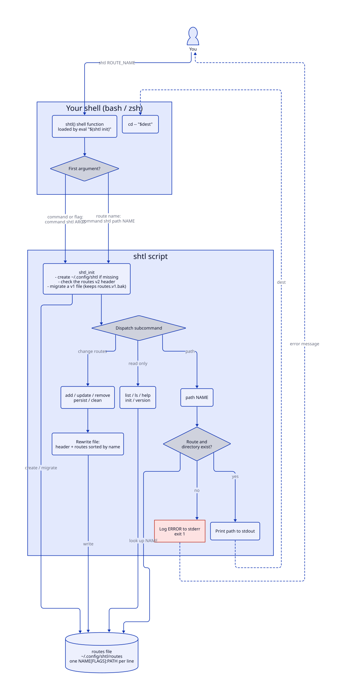

# SHTL

[](https://github.com/bitmvr/shtl/actions/workflows/ci.yml)

## Install

You can install `shtl` from a release or from the source.

### Install from a Release

A release has `shtl` as one file. It is not necessary to use `git` or `make`.

1. Enter these commands:

   ```sh
   mkdir -p ~/.local/bin
   curl -fsSL -o ~/.local/bin/shtl https://github.com/bitmvr/shtl/releases/latest/download/shtl
   chmod +x ~/.local/bin/shtl
   ```

2. Add the shell function to your rc file. Refer to [Shell Integration](#shell-integration).
3. Make sure that `~/.local/bin` is in your `PATH`.

   On Ubuntu, `~/.profile` adds `~/.local/bin` to your `PATH` only if the directory is on the computer when your session starts. Thus, if step 1 made the directory, you must start a new session.

To install a new release, do step 1 again.

### Install from the Source

1. Go to the root directory of the project.
2. Enter this command:

   ```sh
   make install
   ```

   The command installs `shtl` in `~/.local/bin`. It is not necessary to use `sudo`.

3. Make sure that `~/.local/bin` is in your `PATH`. If it is not in your `PATH`, the command shows a warning.

To install `shtl` in a different directory, set `PREFIX`. For example:

```sh
sudo make install PREFIX=/usr/local
```

To remove `shtl`, enter `make uninstall`. If you set `PREFIX` when you installed `shtl`, set the same `PREFIX` again.

## Shell Integration

A script cannot change the directory of your shell. Thus, `shtl` has a shell function that does the `cd` command for the script. The shell function also gives tab completion for route names.

`make install` shows a prompt to add the shell function to your rc file. If you type `y`, it is not necessary to do the steps in this section. `make uninstall` shows a prompt to remove the shell function.

To add the shell function without `make install`, do the steps for your shell.

### zsh

1. Open your rc file:
   - If you set `ZDOTDIR`, open `$ZDOTDIR/.zshrc`.
   - If you did not set `ZDOTDIR`, open `~/.zshrc`.
2. Add these lines after `compinit`:

   ```sh
   # shtl: https://github.com/bitmvr/shtl
   if command -v shtl >/dev/null; then eval "$(shtl init)"; fi
   ```

   If you add the lines before `compinit`, tab completion does not operate.

3. Open a new terminal.

### bash

1. Open your rc file:
   - On macOS, open `~/.bash_profile`.
   - On other systems, open `~/.bashrc`.
2. Add these lines to the end of the file:

   ```sh
   # shtl: https://github.com/bitmvr/shtl
   if command -v shtl >/dev/null; then eval "$(shtl init)"; fi
   ```

3. Open a new terminal.

## Installation Test

1. Enter this command:

   ```sh
   shtl help
   ```

   `shtl` shows its help text:

```

shtl - Help

  Usage: shtl ROUTE_NAME
         shtl COMMAND [ARGS]

    ROUTE_NAME                      Jump to a route (needs the shell function, see init)
    add NAME [PATH] [-p|--persist]  Add a route. PATH must be absolute and defaults to the current directory
                                    --persist allows a directory that doesn't exist yet, and clean skips the route
    update NAME [PATH]              Point a route at a new absolute path. PATH defaults to the current directory
    remove | rm NAME                Remove a route
    list | ls                       List routes
    clean                           Interactively remove routes whose directories no longer exist
    persist NAME                    Toggle whether clean skips a route
    path NAME                       Print a route's path (e.g. cp file "$(shtl path work)")
    doctor                          Check the routes file for problems
    init                            Print the shell function. Add to your ~/.zshrc or ~/.bashrc: eval "$(shtl init)"
    help                            Display this information
    version                         Print the shtl version

```

## Examples

To go to a route, enter `shtl ROUTE_NAME`. These are examples of the commands:

```sh
shtl add work              # save the current directory as "work"
shtl add nas /Volumes/nas --persist
shtl work                  # jump there
shtl ls                    # list routes
shtl clean                 # remove routes whose directories are gone
shtl doctor                # find problems in the routes file
```

## Routes File

### Location

- If you set `XDG_CONFIG_HOME`, the routes file is `$XDG_CONFIG_HOME/shtl/routes`.
- If you did not set `XDG_CONFIG_HOME`, the routes file is `~/.config/shtl/routes`.

### Format

The routes file is plain text. You can change it in a text editor. The first line is the header. Each line after the header is one route, in the format `NAME[FLAGS]:PATH`:

```
# shtl routes v1
nas[persist]:/Volumes/nas
work[]:/Users/me/work
```

| Part | Description |
|---|---|
| `NAME` | The name of the route. |
| `FLAGS` | A list of flags, with a comma between each flag. The list can be empty. |
| `PATH` | The absolute path of the directory. |

At this time, `persist` is the only flag. A route that has the `persist` flag can point to a directory that is not on the computer at this time. Use it to prepare routes for a different computer. `shtl clean` does not remove a route that has the `persist` flag.

The path is the last part of the line. Thus, the path can contain colons and all other characters.

### Route Names

A route name must not:

- Contain `:`, `[`, or `]`.
- Start with `-` or `#`.
- Be the same as a `shtl` command, for example `add` or `list`.

### Find Problems

If you change the routes file in a text editor, make sure that `shtl` can read it. Enter this command:

```sh
shtl doctor
```

`shtl doctor` shows each problem and its line number. It does not change the routes file. Correct the problems in a text editor. `shtl doctor` finds these problems:

- A first line that is not `# shtl routes v1`.
- Windows line endings, or spaces or tabs at the end of a line.
- A line that does not have the format `NAME[FLAGS]:PATH`.
- A flag that is not `persist`.
- A path that does not start with `/`.
- A route name that is not correct, or that is the same as a `shtl` command.
- Two routes that have the same name.

## How It Works

When you enter `shtl ROUTE_NAME`, the shell function sends the route name to the `shtl` script. The script finds the path of the route in the routes file and shows it. Then the shell function goes to that directory.



The diagram source is `docs/pipeline.d2`. If you change the source, enter this command to make the diagram again:

```sh
d2 docs/pipeline.d2 docs/pipeline.svg
```

## Contribute

1. Clone this repository.
2. Make a branch.
3. Make sure that [bats](https://github.com/bats-core/bats-core) is installed. To install it, enter `brew install bats-core`.
4. To do the tests, enter `make test`.
5. Open a pull request with your branch.

To do the lint and the tests automatically before each push, enter `make hooks` one time in each clone.

CI does the lint and the tests on Linux only. On macOS, you must do the tests on your computer.

The tests are in `test/`. The tests use the `shtl` script that `make` makes and a temporary configuration directory. Thus, the tests do not change your routes.
